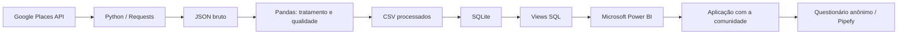
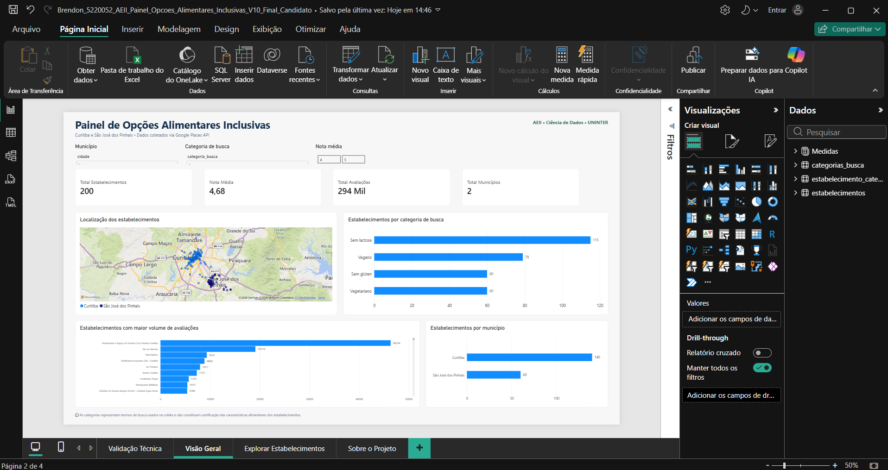
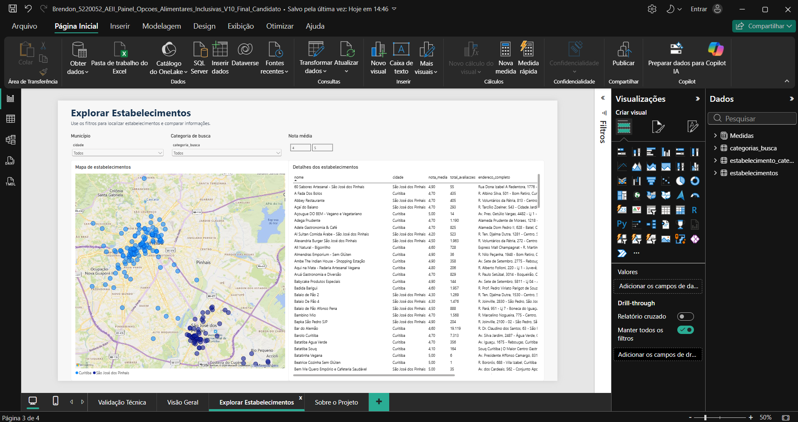

# Painel de Opções Alimentares Inclusivas — AEII/UNINTER

Projeto desenvolvido na **Atividade Extensionista II — Tecnologia Aplicada à Inclusão Digital — Projeto**, do CST em Ciência de Dados da UNINTER.

O objetivo é organizar e disponibilizar, por meio de uma solução de dados, informações sobre estabelecimentos encontrados por termos de busca relacionados a opções alimentares inclusivas em **Curitiba** e **São José dos Pinhais (PR)**.

> **Importante:** as categorias deste projeto representam os termos de busca nos quais os estabelecimentos foram encontrados. Elas **não constituem certificação** de que o local atende integralmente a uma restrição alimentar. Pessoas com alergias, intolerâncias ou outras restrições devem confirmar as condições diretamente com o estabelecimento.

## Arquitetura da solução



## Tecnologias

- Python
- Pandas
- Requests
- python-dotenv
- SQLite
- Microsoft Power BI
- Google Places API (New)
- Pipefy, utilizado na validação anônima com participantes

## Estrutura do repositório

```text
.
├── src/
│   ├── coleta.py
│   ├── tratamento.py
│   └── banco.py
├── data/
│   └── processed/
│       ├── estabelecimentos.csv
│       ├── categorias_busca.csv
│       ├── estabelecimento_categoria_busca.csv
│       ├── coletas.csv
│       └── relatorio_qualidade.json
├── database/
│   ├── schema.sql
│   └── relatorio_banco_sqlite.json
├── powerbi/
│   └── Brendon_5220052_AEII_Painel_Opcoes_Alimentares_Inclusivas.pbix
├── docs/
│   ├── MODELO_DADOS.md
│   ├── VALIDACAO_COMUNIDADE.md
│   └── screenshots/
├── .env.example
├── .gitignore
└── requirements.txt
```

## Resultados da base final

A base consolidada utilizada no painel apresentou:

| Indicador | Resultado |
|---|---:|
| Registros brutos coletados | 364 |
| Place IDs únicos no RAW | 202 |
| Estabelecimentos únicos no escopo | 200 |
| Curitiba | 140 |
| São José dos Pinhais | 60 |
| Relações estabelecimento × categoria | 314 |
| Total de avaliações | 293.651 |
| Nota média dos estabelecimentos | 4,68 |

### Estabelecimentos por categoria de busca

| Categoria | Estabelecimentos |
|---|---:|
| Sem lactose | 115 |
| Vegano | 79 |
| Vegetariano | 60 |
| Sem glúten | 60 |

Um estabelecimento pode aparecer em mais de uma categoria; por isso, a soma das categorias é superior ao total de estabelecimentos únicos.

## Como executar

### 1. Criar o ambiente Python

```bash
python -m venv .venv
```

No Windows:

```powershell
.\.venv\Scripts\Activate.ps1
```

Instale as dependências:

```bash
pip install -r requirements.txt
```

### 2. Configurar a chave da API

Copie `.env.example` para `.env` e informe sua própria chave do Google Places API:

```env
GOOGLE_PLACES_API_KEY=SUA_CHAVE
```

O arquivo `.env` está bloqueado pelo `.gitignore` e **não deve ser versionado**.

### 3. Coletar os dados

```bash
python src/coleta.py
```

A coleta realiza consultas para quatro termos de busca — Vegetariano, Vegano, Sem glúten e Sem lactose — em Curitiba e São José dos Pinhais.

### 4. Tratar e validar os dados

```bash
python src/tratamento.py
```

O tratamento consolida duplicidades por `place_id`, restringe o escopo territorial, gera as tabelas processadas e executa validações de qualidade.

### 5. Criar e validar o banco SQLite

```bash
python src/banco.py
```

O script cria as tabelas relacionais, chaves, restrições e views utilizadas na análise.

### 6. Abrir o Power BI

Abra o arquivo da pasta `powerbi/`. Dependendo do computador, pode ser necessário ajustar o caminho da fonte de dados local antes de atualizar o relatório.

## Modelo de dados

O modelo utiliza quatro entidades principais:

- `estabelecimentos`: cadastro único por `place_id`;
- `categorias_busca`: domínio das categorias pesquisadas;
- `estabelecimento_categoria_busca`: tabela associativa N:N;
- `coletas`: metadados das oito consultas executadas.

Detalhes adicionais estão em [`docs/MODELO_DADOS.md`](docs/MODELO_DADOS.md).

## Dashboard

### Visão Geral



### Explorar Estabelecimentos



O relatório permite analisar KPIs, localização geográfica, distribuição por município, categorias de busca e volume de avaliações, além de explorar os estabelecimentos individualmente.

## Validação com a comunidade

A solução foi aplicada com **6 participantes** e posteriormente avaliada por questionário anônimo. Entre os resultados observados:

- 100% declararam compreender facilmente a finalidade do painel;
- 100% consideraram os filtros fáceis de utilizar;
- 100% afirmaram que o mapa ajudou a localizar os estabelecimentos;
- avaliação média geral: **4,0/5,0**;
- 83,3% responderam **Sim** ou **Talvez** para utilização de uma solução semelhante no dia a dia.

A validação é exploratória e possui amostra reduzida, adequada ao objetivo de verificar funcionamento, clareza e utilidade inicial da solução no contexto extensionista.

Mais detalhes: [`docs/VALIDACAO_COMUNIDADE.md`](docs/VALIDACAO_COMUNIDADE.md).

## Segurança

- Chaves de API não são versionadas.
- O arquivo `.env` é ignorado pelo Git.
- O repositório não contém a chave utilizada durante o desenvolvimento.
- Antes de publicar forks ou versões antigas do projeto, remova quaisquer credenciais eventualmente presentes em scripts de teste.

## Autor

**Brendon Conceição Silvestre Batista**  
CST em Ciência de Dados — UNINTER  
Atividade Extensionista II — Tecnologia Aplicada à Inclusão Digital — Projeto
