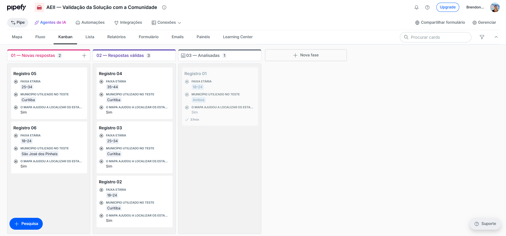

# Validação com a comunidade

A aplicação prática da solução foi realizada com **6 participantes**, que utilizaram o painel no Microsoft Power BI Desktop e responderam posteriormente a um questionário anônimo no Pipefy.

## Procedimento

Os participantes foram orientados a utilizar os filtros de município e categoria, observar os indicadores e gráficos e utilizar o mapa para localizar estabelecimentos. Após a experiência, responderam ao questionário de avaliação.

Nenhum nome, e-mail, telefone ou outro identificador pessoal foi solicitado no instrumento de coleta.

## Síntese dos resultados

| Indicador | Resultado |
|---|---:|
| Participantes | 6 |
| Entenderam facilmente a finalidade | 100% |
| Consideraram os filtros fáceis | 100% |
| O mapa ajudou na localização | 100% |
| Avaliação média geral | 4,0 / 5,0 |
| Avaliaram como Bom ou Excelente | 66,7% |
| Utilizariam no dia a dia — Sim | 50,0% |
| Utilizariam no dia a dia — Talvez | 33,3% |
| Utilizariam no dia a dia — Não | 16,7% |

A combinação das respostas “Sim” e “Talvez” indica **83,3% de aceitação ou potencial de uso** da solução no cotidiano.

## Limitações da validação

A validação possui caráter exploratório, com amostra pequena, e não pretende produzir inferência estatística sobre toda a população. Os testes registrados nesta etapa foram realizados em computador, portanto os resultados não devem ser interpretados como validação específica da experiência mobile.

## Evidência

